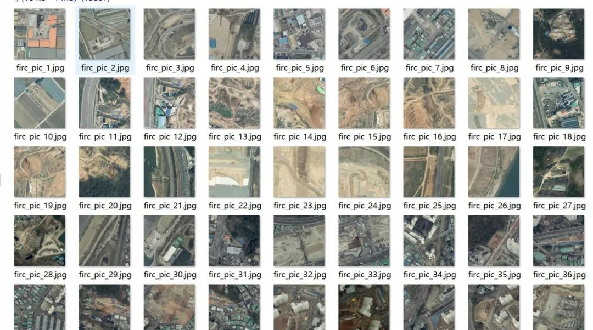
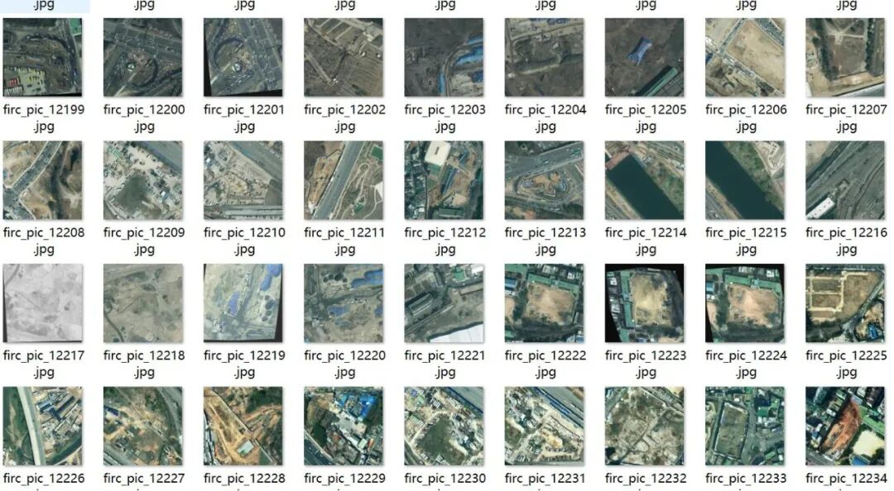
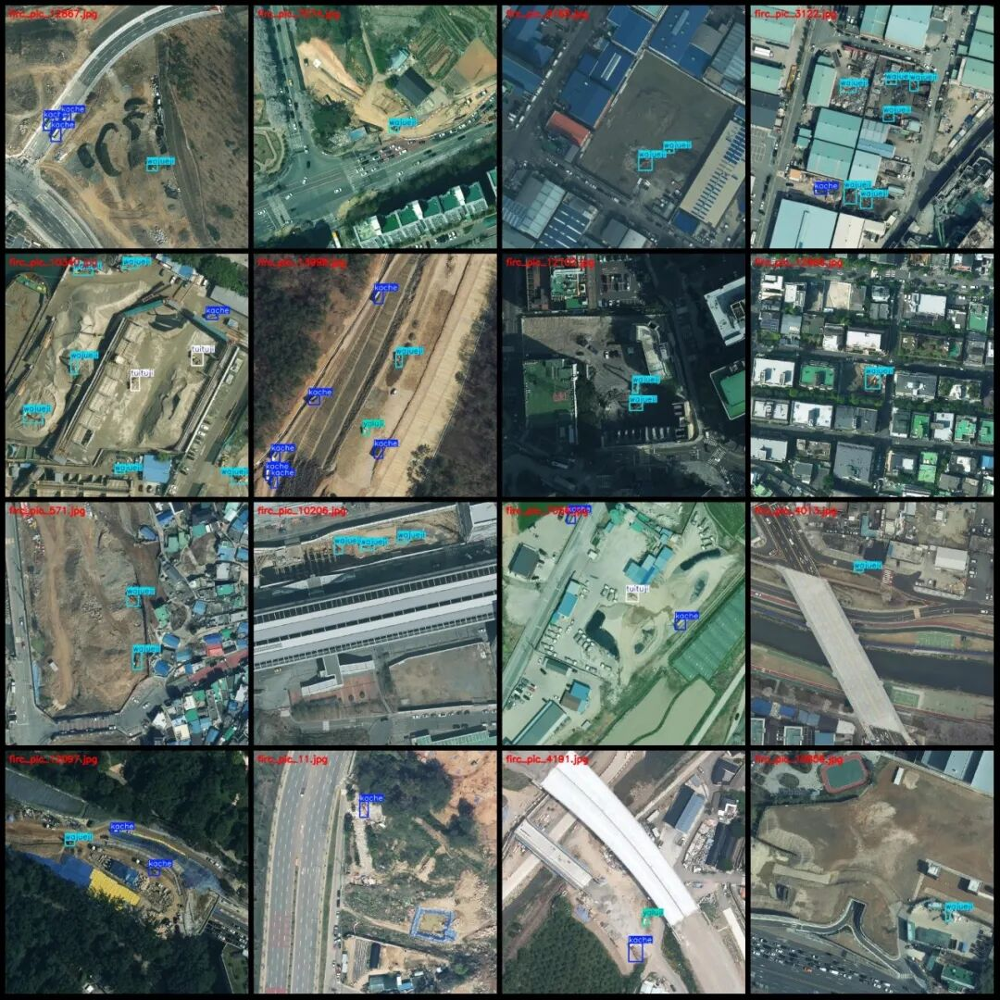
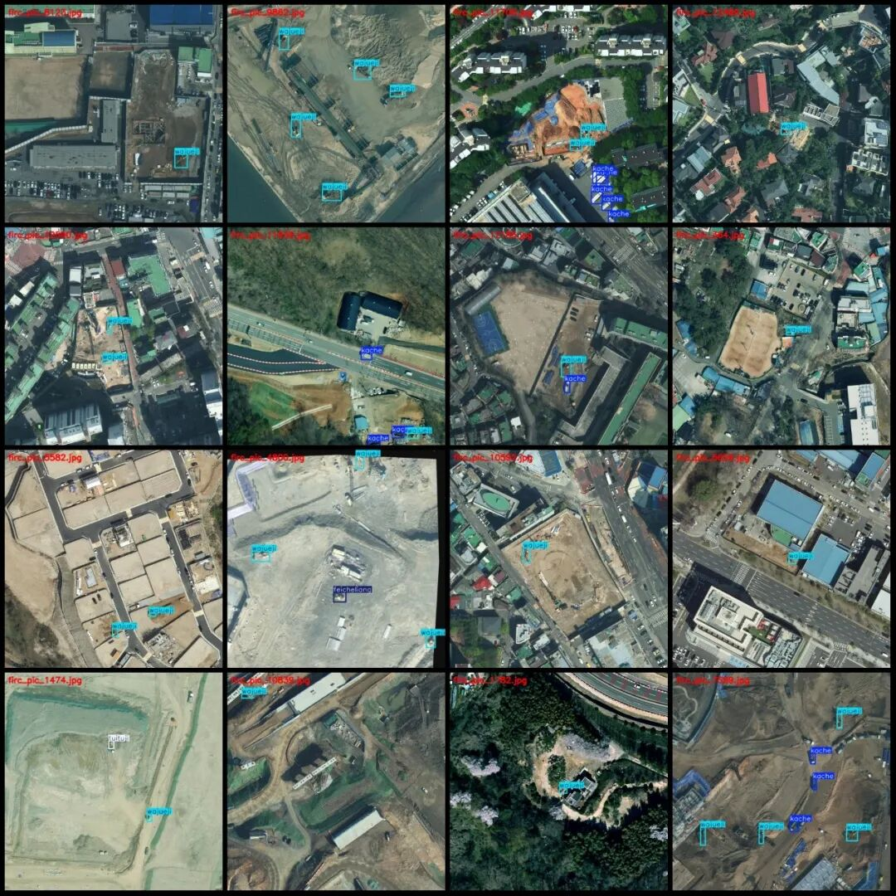
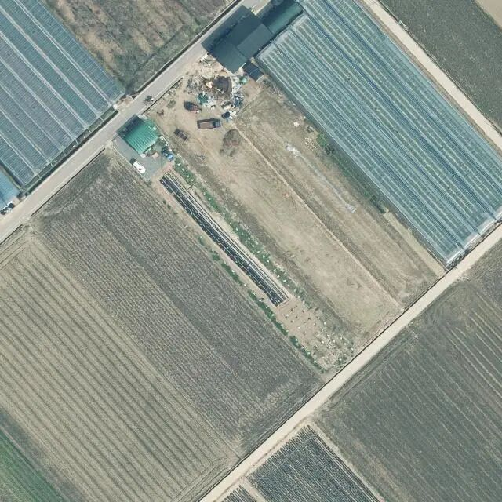
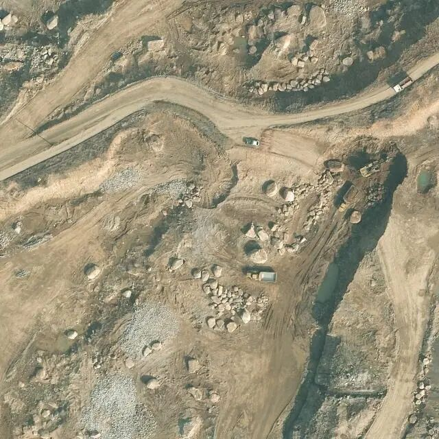
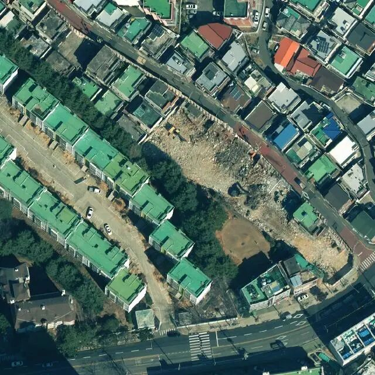

# Remote Sensing Image Engineering Vehicle Detection Dataset VOC+YOLO format with 13867 images in 6 categories

Please note that some images in the dataset have been rotated for enhancement, specifically as shown in the images.

Dataset format: Pascal VOC format + YOLO format (txt file without split path, only containing jpg images and corresponding VOC format xml files and yolo format txt files)

Number of images (number of jpg files): 13867

Number of annotations (number of xml files): 13867

Number of annotations (number of txt files): 13867

Label count: 6

Label category names (Note that the order of categories in the YOLO format does not correspond to this, but is based on the classes.txt file in the labels folder): ["feicheliang", "kache", "pingdiji", "tuituji", "wajueji", "yaluji"]

Number of boxes and the number of images occupied by each category:

Feicheliang frame count = 288, occupying image count = 247

Kache box number = 10499, occupying image count = 4532

Pingdiji box count = 269, occupying image count = 237

tuituji frame count = 1806, occupying image count = 1413

Wajueji frame count = 25707, occupying image count = 12747

Yaluji Frames = 655, Pictures Taken = 580

Total frame count: 39224

Image resolution: 640x640

Using labelImg:

Annotation rules: Draw a rectangle around the category.

Important Notice: The dataset does not have separate training, validation, and test sets; you need to partition them yourself.

Special : This dataset does not guarantee the accuracy of the trained models or weight files.

Image Preview:

Annotation example:

Single image:

## Payment

Here is a pay link on Stripe ( https://buy.stripe.com/3cs8yP7sY87d0vu9AB ). Please contact me lonlonago@foxmail.com after funding $89, and I will send you a complete data files , thank you!

